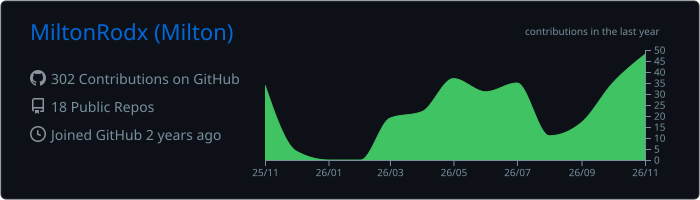
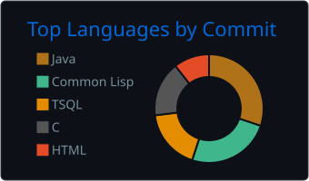

<div align="center">


<a href="https://git.io/typing-svg">
  
</a>


</div>

---

### Sobre mí

Desarrollador Full-Stack en formación y entusiasta de Linux. Estudiante de la Licenciatura en Sistemas de Información en la Universidad Nacional del Nordeste (UNNE), Argentina.

Trabajo en el desarrollo completo de aplicaciones: modelado y consultas de bases de datos, APIs backend, interfaces web y despliegue con contenedores. Me interesa entender cómo funcionan las cosas por debajo y escribir código claro, mantenible y bien estructurado.

---

### Stack

<div align="center">

**Frontend**

[](https://skillicons.dev)

**Backend**

[](https://skillicons.dev)

**Bases de datos**

[](https://skillicons.dev)

**Infraestructura y herramientas**

[](https://skillicons.dev)

</div>

---

### Áreas de trabajo

| Área | Detalle |
|---|---|
| **Backend** | APIs REST con Java/Spring y .NET, acceso a datos con JDBC, separación en capas |
| **Frontend** | React y TypeScript, diseño responsive con CSS (flexbox y grid) |
| **Bases de datos** | PostgreSQL, SQLite y SQL Server: modelado, DDL/DML, consultas y manejo de NULLs |
| **DevOps** | Docker y Docker Compose, despliegue en AWS y VPS |
| **Linux** | Uso diario de Debian, scripting en Bash, administración de paquetes y entorno |
| **Aplicaciones de escritorio** | Java con JavaFX y AtlantaFX, persistencia en SQLite |

---

### En lo que estoy trabajando

- Entornos de datos con **PostgreSQL y pgAdmin** sobre Docker Compose
- Aplicaciones en **Java** con persistencia **SQLite + JDBC** e interfaz **JavaFX**
- Landings y sistemas de gestión para negocios locales
- Profundizando en desarrollo web con **The Odin Project**
- Formación universitaria en Sistemas de Información (UNNE)

---

### Estadísticas

<p align="center">
  
  
</p>

<p align="center">
  
  
</p>

---

### Entorno de trabajo

```text
Sistema     Debian + GNOME
Editores    VS Code, IntelliJ IDEA
Shell       Bash
Datos       PostgreSQL (Docker), DBeaver, pgAdmin
Control     Git y GitHub
```

---

### Contacto

<p align="center">
  <a href="https://ar.linkedin.com/in/milton-nahuel-rodriguez-rivas-255248247"></a>
  <a href="https://github.com/USERNAME"></a>
</p>


